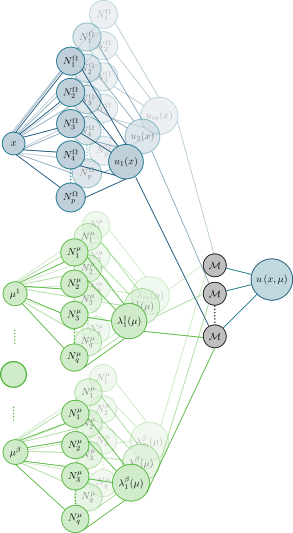

## Why a lung digital twin (DT)?




:::: {.columns}

::: {.column width="50%"}

{ height="250" loop="true" autoplay=true}

:::

::: {.column width="50%"}

{ height="250" loop="true" autoplay=true}

:::

::::

:::: {.columns}

::: {.column width="50%"}

:::: {.mybox}

::: {.mybox-header}
Objectives
:::

::: {.mybox-body}

* Improved understanding of the **mechanically-driven** physiological mechanisms
  * *e.g.* fibrosis, ventilation, perfusion
* *In silico* prognostics
  * Transfer tools to the clinic
  * Patient-specific **digital twins**

:::

::::

:::

::: {.column width="50%"}

:::: {.mybox}

::: {.mybox-header}
Requirements
:::

::: {.mybox-body}

:::: {style='margin-top: 2em;'}
::::

::: {.fragment fragment-index=1 .fade-in}

* [1) Mechanical model of the lung]{.positive}
:::

::: {.fragment .fade-in}
* [2) Image-based personalisation & uncertainty quantification]{.warning}

:::

::: {.fragment .fade-in}
* [3) **Real-time** estimation of the parameters]{.important}
:::

:::: {style='margin-top: 1.9em;'}
::::

:::

::::

:::

::::

## Modelling & image-based personalisation

:::: {.columns}

::: {.column width="50%"}

:::: {.mybox}

::: {.mybox-header}
Lung poro-mechanics - two scales
:::

::: {.mybox-body}

* **Macro**: finite-strain **poro-mechanical** model of the parenchyma [@patteQuasistaticPoromechanicalModel2022;@peyrautModelMechanicalLoading2024a]
  * Solid skeleton + air, hyperelastic potentials $\Psi_s\left(\matrice{E}, \Phi_s\right)$
  * **Pleural pressure**: data-driven reduced-order model (**Felipe Álvarez-Barrientos**)
* **Micro**: alveolar microstructure [@manoochehrtayebiFiniteStrainMicroporomechanics2025]
  * Blood perfusion (**Haotian Xiao**)

:::

::::

![Fibrosed zones [@peyrautQuantificationDincertitudesPour2024a]](Figures/fibrosed.png){ width="40%" fig-align="center"}

:::

::: {.column width="50%"}

::::: {.fragment .fade-in}

:::: {.mybox}

::: {.mybox-header}
Motion tracking & personalisation
:::

::: {.mybox-body}

* **Equilibrated warping** [@genetEquilibratedWarpingFinite2018]
  * Finite element image registration
  * Mechanically regularised (equilibrium gap)
* Patient-specific estimation of regional compliance [@lavilleComparisonOptimizationParametrizations2023]
* Uncertainty quantification [@peyrautQuantificationDincertitudesPour2024a]

:::: {style='margin-top: 1.25em;'}
::::

:::

::::

{ height="230" loop="true" autoplay=true fig-align="center"}

:::

:::::

::::

## Towards real-time digital twins

:::: {.columns}

::: {.column width="55%"}

<iframe src="https://alexandredabyseesaram.github.io/Resources/AR/Breathing_ROM_SVK.html" allow="fullscreen" style="border:none; width:760px; height:520px; max-width:none; max-height:none; transform:scale(0.52); transform-origin:0 0;"></iframe>

[]{style="font-size:0.5em"}

:::

::: {.column width="17%"}

{ height="230" fig-align="center"}

:::

::: {.column width="28%"}

{ height="230" loop="true" autoplay=true fig-align="center"}

:::

::::

:::: {style='margin-top: -2em;'}
::::

:::: {.columns}

::: {.column width="50%"}

:::: {.mybox}

::: {.mybox-header}
Surrogate modelling - NeuROM
:::

::: {.mybox-body}

* **Interpretable** reduced-order model (hybrid FE / NN-PGD)
  * [@skardovaFiniteElementNeural2025;@daby-seesaramFiniteElementNeural2025]
* Parametrised solution learned **offline** as a PGD approximation
  * Material, loading **and patient shape** parameters

$$
\vect{u}\left(\textcolor{Blue}{\vect{x}}, \textcolor{LGreen}{\para}\right) = \sum\limits_{i=1}^m \textcolor{Blue}{\overline{\vect{u}}_i(\vect{x})} ~\textcolor{LGreen}{\prod_{j=1}^{\beta}\lambda_i^j(\mu^j)}
$$

* **On-the-fly** evaluation online: real-time simulation

:::

::::

:::

::: {.column width="50%"}

:::: {.mybox}

::: {.mybox-header}
Enriching the digital twin
:::

::: {.mybox-body}

:::: {style='margin-top: 3.3em;'}
::::

* **Micro-buckling** of the alveolar walls (PhD: **Solal Espic**)
  * Account for alveolar collapse & step towards multi-scale DT
* **Pleural pressure model** in the DT (PhD: **Salvador Gonzalez**)
  * State-of-the-art macro model incorporated in the DT
* Applications: diagnostics, prognostics, control of medical devices

:::: {style='margin-top: 3.3em;'}
::::

:::

::::

:::

::::

## References {visibility="uncounted"}

::: {#refs}
:::
